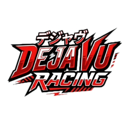
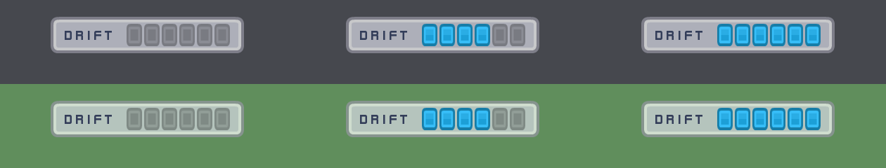
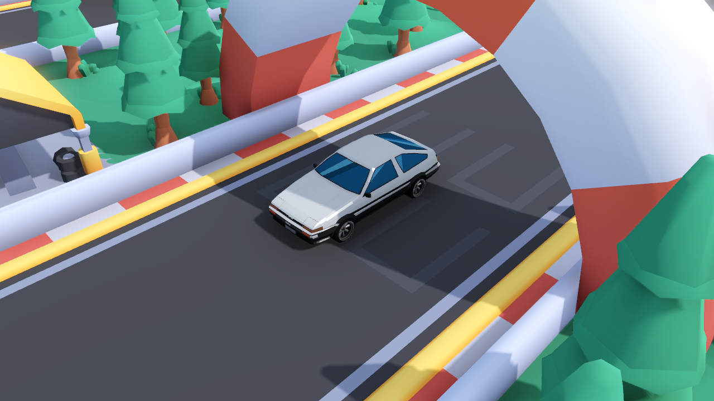

# Deja Vu Racing

This project started as a fork of Kenney's Starter Kit Racing with the goal of creating a arcade racing experience freely inspired by Initial D and the JDM drift culture.

This package includes a basic template for a racing game in Godot 4.6. Includes features like:

- Arcade-like vehicle controls

- Custom Toyota AE86 3D car model

- Animated wheel rotation and steering tilt

- Eurobeat-inspired soundtrack ("Dejavu Kaze")

- Particle smoke effects

- GridMap based track creation

- Base 3D models & sound effects (CC0 licensed)

- New drift bar

### Screenshot

### Controls

| Key | Command |
| --- | --- |
| <kbd>W</kbd> | Accelerate/brake |
| <kbd>S</kbd> | Brake/reverse |
| <kbd>A</kbd> <kbd>D</kbd> | Steering |

### Instructions

#### 1. How to adjust the track?

Select the 'GridMap' node and place pre-made tiles in the world.

#### 2. How to change the car model?

Choose one of the included vehicles in the project (for example 'vehicle-truck-yellow.glb') and drag it into the project as a child of 'Container'. Then change the name to 'Model'.

#### 3. How to add custom car models?

Follow the same steps as seen above but make sure your model has the following children;

- `body` The body of the vehicle

- `wheel-front-left` The front left wheel of the vehicle

- `wheel-front-right` The front right wheel of the vehicle

- `wheel-back-left` The back left wheel of the vehicle

- `wheel-back-right` The back right wheel of the vehicle

#### 4. How to change from a car to a motorcycle?

Remove the 'Vehicle' node from the main scene. Find the 'vehicle-motorcycle.tscn' scene and place it in your main scene, make sure to adjust the 'View' node to target the new vehicle.

### License

MIT License

Copyright (c) Kenney / LemoniceIT

Permission is hereby granted, free of charge, to any person obtaining a copy
of this software and associated documentation files (the "Software"), to deal
in the Software without restriction, including without limitation the rights
to use, copy, modify, merge, publish, distribute, sublicense, and/or sell
copies of the Software, and to permit persons to whom the Software is
furnished to do so, subject to the following conditions:

The above copyright notice and this permission notice shall be included in all
copies or substantial portions of the Software.

THE SOFTWARE IS PROVIDED "AS IS", WITHOUT WARRANTY OF ANY KIND, EXPRESS OR
IMPLIED, INCLUDING BUT NOT LIMITED TO THE WARRANTIES OF MERCHANTABILITY,
FITNESS FOR A PARTICULAR PURPOSE AND NONINFRINGEMENT. IN NO EVENT SHALL THE
AUTHORS OR COPYRIGHT HOLDERS BE LIABLE FOR ANY CLAIM, DAMAGES OR OTHER
LIABILITY, WHETHER IN AN ACTION OF CONTRACT, TORT OR OTHERWISE, ARISING FROM,
OUT OF OR IN CONNECTION WITH THE SOFTWARE OR THE USE OR OTHER DEALINGS IN THE
SOFTWARE.

Assets included in this package (2D sprites, 3D models and sound effects) are CC0 licensed

The skid sound effect was made by Landeplage and is also CC0 licensed

### THIRD-PARTY ASSETS & CREDITS

3D Models:
- "Toyota AE86" by IvOfficial
  Licensed under Creative Commons Attribution (CC-BY 4.0)
  Source: Poly Pizza (https://poly.pizza/)

Audio & Soundtrack:
- "Dejavu Kaze" generated via Suno AI
  Licensed under Suno Terms of Service (Non-Commercial Use Only)
  Source: https://suno.com/s/eWi3QKRFB9xy19Ha

  Sound Effect (car engine) by <a href="https://pixabay.com/it/users/finlo-43919229/?utm_source=link-attribution&utm_medium=referral&utm_campaign=music&utm_content=238996">Niilo Laitamäki</a> from <a href="https://pixabay.com//?utm_source=link-attribution&utm_medium=referral&utm_campaign=music&utm_content=238996">Pixabay</a>
